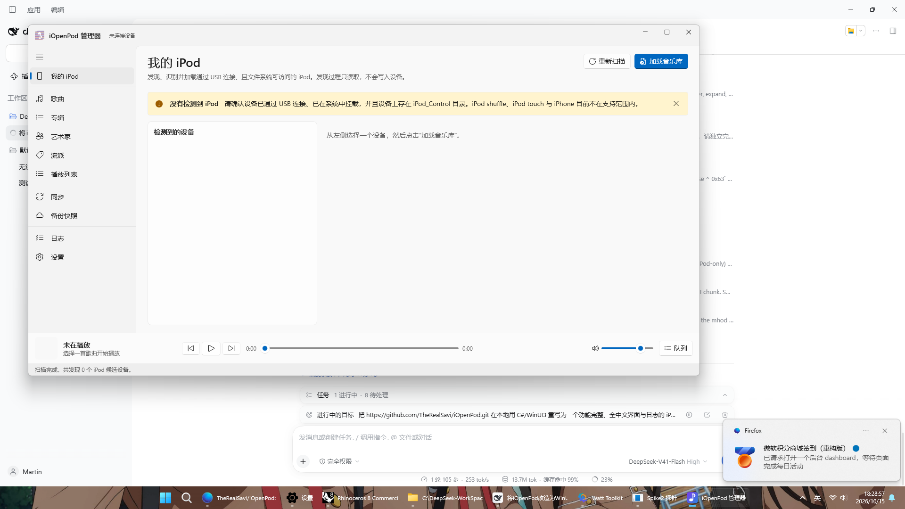

# iOpenPod 管理器 —— C# / WinUI 3 中文重制版

**你的音乐，你的 iPod。**

[](LICENSE)
[]()
[]()
[]()
[]()

[**⬇ 下载最新版**](https://github.com/LemonStudio-OpenSource/iOpenPod-CSharp/releases/latest) ·
[使用说明](csharp/README.md) ·
[原项目](https://github.com/TheRealSavi/iOpenPod)



---

## 这是什么

[TheRealSavi/iOpenPod](https://github.com/TheRealSavi/iOpenPod) 的**完全 C# 重写版**。

原项目由约 14 万行 Python + Qt6 构成；本仓库把它的核心能力用 **C# / .NET 10 / WinUI 3** 重新实现，
**界面、日志、异常提示、设备型号名与所有用户可见内容全部为中文**，
发行包自带 .NET 运行时，解压即用。

| | 原版 | 本重制版 |
| --- | --- | --- |
| 语言 | Python 3.12 | C# 13 / .NET 10 |
| 界面 | PySide6（Qt 6） | WinUI 3（Windows App SDK 1.8） |
| 界面语言 | 多语言，默认英文 | **简体中文** |
| 交付形式 | 需打包的 Python 发行版 | 自带运行时的单目录可执行程序 |
| 平台 | Windows / macOS / Linux | Windows x64 |

## 快速开始

1. 到 [Releases](https://github.com/LemonStudio-OpenSource/iOpenPod-CSharp/releases/latest) 下载 `iOpenPod-v3.0.0-win-x64.zip`，**完整解压**。
2. 双击 `首次运行-安装运行时.cmd`（安装一次微软官方的 Windows App Runtime 1.8，不需要管理员权限）。
3. 双击 `iOpenPod.exe`。

> 为什么必须先装运行时：WinUI 3 应用除了自带 .NET 之外，还需要操作系统级的
> Windows App Runtime 才能初始化图形合成器。缺少它时窗口会出现、标题栏也正常，
> 但客户区一片空白且不报任何错。发行包里的 `Runtime\` 目录已经附带微软官方的四个 MSIX 组件。

## 功能

* **浏览** —— 歌曲 / 专辑 / 艺术家 / 流派四种视图，封面缩略图、搜索、多字段排序、专辑详情页。
* **播放** —— 底部播放条、播放队列、歌词面板。
* **编辑** —— 曲目元数据编辑器（支持多选批量应用）、播放列表增删改、设备重命名。
* **同步** —— 扫描宿主媒体文件夹，自动解析 ID3v1 / ID3v2.2-2.4、MP4、FLAC、Vorbis、WAV、AIFF、ASF
  标签与内嵌封面，生成新增 / 更新 / 移除计划（移除项默认不勾选），在一个可恢复事务中提交。
* **备份快照** —— 完整备份 `iPod_Control` 与 `Photos`，还原前强制再创建一次安全快照。
* **安全写入** —— 暂存 → SHA-256 校验 → 写日志 → 发布 → 删除 → 校验 → 清理，全程可回滚。
* **中文日志** —— 界面实时查看、筛选、复制，也可直接打开日志目录。

### 支持范围

| 家族 | 支持世代 | 读写 |
| --- | --- | --- |
| iPod / iPod classic | 第 1–5.5 代、classic 6 / 6.5 / 7 代 | 完整读写 |
| iPod mini | 第 1、2 代 | 完整读写 |
| iPod nano | 第 1–4 代 | 完整读写 |
| iPod nano | 第 5、6、7 代 | 只读 |

iPod shuffle、iPod touch、iPhone 不在支持范围内。

## 技术要点

**无损数据库。** iTunesDB / ArtworkDB / PhotosDB 表示成一棵保留原始字节的数据块树，
写入时只重算「长度」与「子块计数」两类结构字段 —— 解析后立即写回可以**逐字节重现**原始文件，
未知字段、填充、保留区与尾部数据都不会丢失。校验程序用真实捕获的数据库证明了这一点。

**三类签名全部支持。**

| 方案 | 使用机型 | 实现 |
| --- | --- | --- |
| HASH58 | classic 6/7、nano 3/4 | AES S 盒由有限域定义现算，HMAC-SHA1 密钥由 FireWire GUID 派生 |
| HASH72 | nano 5 | AES-128-CBC 信封；IV 与随机数从设备 `HashInfo` 或已签名数据库恢复 |
| HASHAB | nano 6/7 | 从 [dstaley/hashab](https://github.com/dstaley/hashab) 的公有领域 C 实现移植，含 EDON-R′ 256 与 Apple 密码表 |

**架构边界清晰。** 依赖方向严格单向，格式知识只存在一处：

```
iOpenPod.WinUI  →  iOpenPod.App  →  iOpenPod.IPodDb  →  iOpenPod.DeviceRegistry
                        ↓                                      ↑
                   iOpenPod.Storage  ──────────────────────────┘
```

| 工程 | 职责 |
| --- | --- |
| `iOpenPod.Storage` | 卷发现、身份绑定的文件系统会话、可恢复写入事务、原生安全弹出 |
| `iOpenPod.DeviceRegistry` | 151 个型号目录、SysInfo 解析、基于证据的识别（不触碰硬件） |
| `iOpenPod.IPodDb` | 无损数据块树、iTunesDB / ArtworkDB / PhotosDB、签名、iTHMB 编解码 |
| `iOpenPod.App` | 设备协调、音乐库会话、同步引擎、备份、播放、设置、中文日志 |
| `iOpenPod.WinUI` | WinUI 3 中文界面 |

## 从源码构建

需要 **.NET 10 SDK** 与 Windows 10 1809 以上。

```shell
git clone https://github.com/LemonStudio-OpenSource/iOpenPod-CSharp.git
cd iOpenPod-CSharp/csharp
dotnet build iOpenPod.sln -c Release -p:Platform=x64
```

生成发行包（自动附带运行时的官方 MSIX 组件与一键安装脚本）：

```powershell
powershell -ExecutionPolicy Bypass -File build/publish.ps1
```

### 运行离线校验

```shell
dotnet run --project csharp/tests/iOpenPod.Verification -c Release
```

校验内容：真实捕获的 iTunesDB / ArtworkDB / PhotosDB 逐字节往返、HASH58 官方向量、
HASHAB 全部 100 组官方向量、设备目录与 SysInfo 识别、编辑后逐字节复原、播放列表增删往返。
当前 **26 项全部通过**。

## 已知限制

* iPod nano 第 5 / 6 / 7 代使用压缩 iTunesCDB **加** SQLite 音乐库，目前只能浏览、播放与备份，
  不能写入；界面会明确提示原因。其余机型可完整读写。
* 同步默认保持原格式，不做音频转码。
* 尚未实现：智能播放列表规则编辑、照片库管理、播客订阅、Last.fm / ListenBrainz 记录、
  macOS / Linux 版本、应用内自动更新。

## 仓库结构

```
csharp/                    C# / WinUI 3 重制版（本仓库的主体）
├─ src/                    五个工程，见上文职责表
├─ tests/                  离线校验程序
├─ build/                  发布脚本与运行时安装脚本
└─ README.md               重制版详细文档
src/ packaging/ website/   原项目的 Python / Qt 实现（保留以便对照与追溯）
docs/ tests/               原项目的文档与测试
README-upstream.md         原项目 README
```

## 授权与致谢

本项目沿用原项目的 **GPL-3.0-or-later** 授权，见 [LICENSE](LICENSE)。

* 上游项目：[TheRealSavi/iOpenPod](https://github.com/TheRealSavi/iOpenPod)
* HASHAB 算法：[dstaley/hashab](https://github.com/dstaley/hashab)（Unlicense，公有领域）
* 格式研究参考：libgpod、gtkpod

iPod 与 iTunes 是 Apple Inc. 的商标；本软件是独立作品，与 Apple 无任何关联，也未获得其背书。
